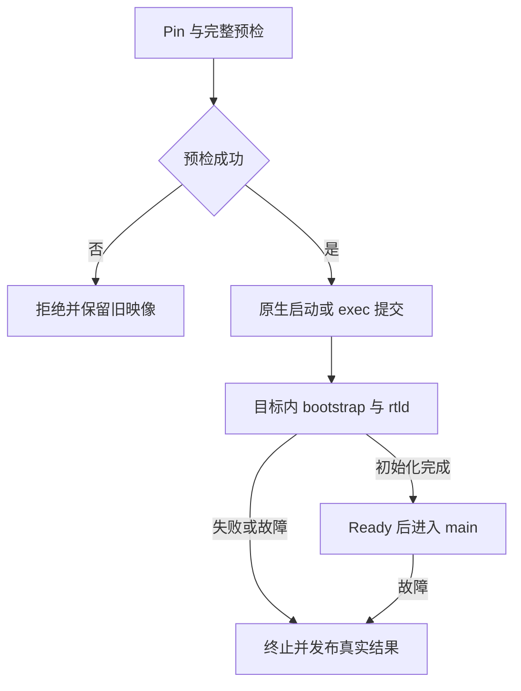

# D0：XOS 原生动态链接契约设计

2026-11-25，**设计 v1，运行时未实现/未验收**。本页固定目标语义、信任与失败
边界，供 [D1–D4](../plans/glibc_port_scout.md#动态链接明确目标与独立验收) 分模块
实施；不修改 ELF 准入、共享头、syscall 编号、启动布局或默认 SDK。下面出现的
新 identity、加载描述和 ready/error 记录是待登记的逻辑接口，尚无可用 wire 编码。
当前静态 loader 继续拒绝动态 ELF。依据 [宪法](../xos_plan.md) C01/C09/C16/
C20/C22/C25/C31、[ABI 登记](abi_registry.md) 与 [Discipline](../Discipline.md)。

## 1. 已有基础与实际缺口

| 已核对的现状 | D0 对后续工作的约束 |
|---|---|
| [ELF parser](../../src/user/loader/elf.cpp) 接受 ET_EXEC；拒绝 ET_DYN、PT_INTERP、PT_DYNAMIC，忽略若干 NOTE/RELRO 元数据 | 新动态分支单独准入，不放宽旧静态分支后假定兼容 |
| [原生装载 ABI](../e04_loader_sdk.md) 由父方填充 owned building 地址空间，失败 abort；现 sys17 映射低窗口，提交后不能继续 map | 不把 map 当作运行期重保护或文件映射 |
| [sys67 共享头](../../src/shared/include/xos/vm_abi.hpp) 与实际内核提供自身高地址匿名 reserve/commit/protect/decommit/unmap | 复用真实机制；文件映射、低窗口 image protect 和新的跨进程操作须另论证 |
| VM 历史已有页权限、失败回滚、pin、fork/exec 等客体记录；[恢复记录](../work_log/58b24599_vm3_lifecycle_sdk.md) 仍保留整体资格边界 | 目标系统/SDK 重新绑定 D1 所需组合；不凭成功的 info 请求推定全部能力 |
| [glibc dl-sysdep](../../src/ports/glibc/sysdeps/xos/dl-sysdep.c) 在 SHARED 下明确拒绝；静态 CRT 只提供自己的 argv/env/auxv 桥 | 动态解释器必须完成独立 native startup，不能原样套 Linux 初始栈 |
| [文件 pin](file_identity.md) 绑定已打开 inode 的不可写内容；rename/unlink 不会改绑旧对象 | 认证、解析、复制使用同一 pin；路径预检后重新打开不足以保证实际字节 |
| [P3 v1](xypm_repository_v1.md) 提供离线摘要与精确依赖，发行签名/撤销/防回滚仍独立推进 | SDK/profile 候选绑定供审查；执行信任根由激活策略定义 |

本页按基线源码核对这些边界。VM 旧提案中的 BLOCKED 文字、全局旧快照、在途 PR
各自保留历史；实际支持面以共享定义、当前实现和匹配证据一起判断。

## 2. 职责与信任链

| 主体 | 职责和权限 |
|---|---|
| 内核 | 认证 PID/TID、构造所有权、映射权限、IPC、等待、撤销和资源回收；不解析 ELF、SONAME、路径或签名 |
| 受信启动方 | 根据受控激活策略选择 bootstrap/解释器/应用闭包，pin 与预检，准备原生 spawn/exec；只委派已有权限的子集 |
| `xos_rtld_bootstrap` | 无 libc 的原生入口桥，建立本进程动态加载环境，转交真实 glibc rtld；不另造符号解析器或 pthread 实现 |
| glibc rtld | 复用上游依赖、符号版本、重定位、TLS 与 init/fini 算法；XOS 后端实现经过审查的 I/O、VM、启动和失败语义 |
| files / xypm | files 提供已认证会话与稳定对象；xypm 验证和安装材料。安装或可读文件不授予构造、设备、维护或其他执行权限 |

信任链依次说明：上游源归档签名、SDK 的完整产物/工具/移植输入、发布者与应用
包身份、被批准的激活 generation、运行时内核 authority。每层都有自己的输入与
证据。glibc/GCC 上游签名只能认证各自源归档，不能替应用发布者签名，也不能批准
某一 SDK 运行。PR #164 的候选生成保持待客体验收状态。

初期离线开发可以由受信操作者显式固定 bootstrap、解释器、应用及每个 DSO 的
完整摘要；策略来源必须受控，例如与已验证系统镜像绑定的只读配置。一个普通可写
文件即使名为 policy，也不能自动成为信任根。正式发行需 P3 后续可信根、签名、
密钥轮换、撤销和持久防回滚实现及验收；缺项时保留离线开发范围。

对象在进程内运行后拥有该进程可用的 authority。装载 DSO 不建立新隔离边界；
受信程序加载任意恶意代码后，无法靠 SONAME 或符号可见性隔离它。特权/服务应用
必须对完整闭包使用相同严格激活准入，不开放环境注入，也不根据名称、UID 0 或
ELF 自报字段扩大权限。身份路线见 [权限设计](../plans/permission_model_glibc.md)。

## 3. 原生 ABI 身份、版本与拒绝

目标动态 profile 的逻辑 ABI 名为 `xos_glibc_dynamic_v1`，独立于现有 newlib 和
`xos_glibc_static_research_v1`。实际 SDK、CRT、rtld、共享 libc/libstdc++、头、
包 profile、输出、仓库和安装盘成套生成；一个进程只用一个 libc/线程运行库。
当前 xypm v1 的单 profile 数据库规则继续有效，同盘混装另立契约。

每个对象的 native identity 至少绑定以下语义。对象本身由工具链输出的只读身份
材料与激活清单交叉验证；具体载体、长度、枚举值和兼容策略须在 D1 解码器实施前
进入共享契约及 ABI 登记，不复用旧 startup 保留位或冒领 GNU OS ABI 编号。

| 字段 | 约束 |
|---|---|
| identity schema / native ABI | v1 / `xos_glibc_dynamic_v1`；未知主版本拒绝，次版本按显式兼容集合准入 |
| 架构 | ELF64、little endian、x86-64 LP64、原生 syscall ABI；要求的 ISA/CPU feature 显式列出 |
| 运行库、线程、TLS、入口 | glibc、原生 1:1 线程、AMD64 variant II、独立动态 native startup 版本 |
| 对象角色 | bootstrap、解释器、PIE main 或 DSO；角色与 ELF 类型及允许的动态标签一致 |
| profile / SDK / object | profile ID、工具/ABI 身份；外部激活记录绑定完整 SDK/对象摘要和长度；核对实际 SONAME、版本定义和需求 |
| 构建来源 | 已验证源锁、工具、移植补丁和构建回执；与对象实际字节一致 |

完整 SDK 产物摘要和对象自身摘要存于受信外部记录，不嵌入它们所覆盖的对象形成
循环。ELF 内只读身份与外部记录按已登记字段匹配，再对完整对象字节核验摘要。

ELFOSABI 的 0/3、GNU ABI tag、`GLIBC_*` 符号版本、文件后缀或相同 machine 都不能
单独提供原生身份。身份缺失、记录冲突、未知版本、foreign/Linux 对象、newlib
依赖和不在激活闭包中的摘要在运行任何对象代码前拒绝。旧静态 ELF 的已发布准入
保持原规则；缺少新身份的静态应用仍使用原入口，不自动进入动态分支。

目标 `PT_INTERP` 路径固定为 `/usr/lib/xos/glibc_dynamic_v1/ld_xos_x86_64.so.1`。
这是新 profile 的设计名，当前没有该可执行产物。必须恰有一个 NUL 终止、长度
受限的规范绝对路径，且完整字节匹配激活策略；拒绝相对路径、重复段、嵌入 NUL
尾部数据、第二解释器及别名。路径定位后仍核角色、native identity 和实际摘要。
glibc 当前 [shlib-versions](../../src/ports/glibc/sysdeps/xos/shlib-versions) 的
实验 SONAME/GLIBC_2.44 输入保留研究性质；发行 SONAME 和版本兼容集合在真实
共享构建完成后显式冻结，不能借用 Linux 名称推导兼容。

## 4. 依赖闭包、搜索与输入预算

启动方先捕获一个激活 generation，获得 main/解释器及完整 DSO 图的精确摘要。
`DT_NEEDED` 只接受无斜杠的已登记 SONAME，映射为该 generation 的唯一对象；
同名不同摘要、缺库、版本不符、缺边和环在预检阶段拒绝。相同对象只建一个实例，
重用以 profile/generation/摘要身份判定，不用裸路径、FD 槽或地址作为全局身份。

第一批动态 profile 不搜索 cwd、用户目录、空路径项、`$ORIGIN`、RPATH/RUNPATH、
`ld.so.cache`、hwcaps 目录或网络镜像；这些入口明确拒绝/禁用。`LD_PRELOAD`、
`LD_LIBRARY_PATH`、`LD_AUDIT`、`LD_DEBUG`、`GLIBC_TUNABLES` 等影响加载器的环境
由受信启动路径和 rtld 两处过滤，不能只清掉几个熟悉的变量而留可注入旁路。
普通应用环境按独立白名单传递，argv 和用户路径不携带伪装的可信加载描述。

包管理依赖图与 ELF 符号作用域各有语义：P3 的依赖优先安装序列不能直接拿来作
符号查找顺序。rtld 保留 `DT_NEEDED` 的顺序和上游 ELF/glibc 作用域规则，核对
symbol visibility、weak/strong、版本定义/需求、缺版本、重复定义和 C++ ODR。
第一批不开放额外 preload、环境驱动的符号覆盖、audit、filter/auxiliary 或多
namespace；闭包内部的正常 ELF 符号抢占按已声明的上游作用域处理。

预检和运行期解析都显式限制对象数、依赖边、PHDR、dynamic/symbol/version/hash/
relocation 表长度、字符串、映射字节、TLS 与总工作量；全部乘加、load bias、页
对齐和索引先检查溢出。具体数值由 D1 的真实 glibc/C++ 闭包测量后登记，不能沿用
静态 loader 的 8 LOAD/32 PHDR 上限后悄悄截断。现有每会话 16 句柄、全局 32
打开描述、每进程 256 MiB 用户页和线程/TLS 上限是实际硬边界，加载预算还须扣除
原 FD、bootstrap、元数据和暂存副本。超预算在产生可运行半成品前失败。

## 5. 推荐启动路径与地址布局

推荐保留一个小型、受信、无 libc 的静态 bootstrap，通过现有原生创建/替换机制
启动；随后在**自己的**高匿名 arena 映射真正的 glibc rtld、PIE main 和 DSO。
bootstrap 只做原生启动适配、验证和映射交接，上游 rtld 继续负责动态链接算法。
它不能成为第二套 ELF 权限政策、TLS 算法或通用运行库。

| 地址/机制 | 当前范围与 D1 必证事项 |
|---|---|
| 旧用户窗口 | `[0x40000000, 0x80000000)`；低窗 bootstrap 必须避开 heap/TLS/线程 arena/栈/startup 保留区 |
| 旧主栈/startup | 128 KiB / 16 KiB；新加载描述、argv/env 和 FD 信息须有统一有界布局，超限拒绝 |
| 高匿名 arena | `[0x100000000000, 0x200000000000)`；reserve 不产生文件映射或自动缺页装入 |
| 目标 ELF | 真正 PIC 的 ET_DYN 解释器/DSO 和原生 PIE；所选 load bias、跨度、相对重定位范围、TLS offset 与实际 GCC 输出逐项检查 |
| 保护 | reserve NONE → commit RW+NX → 复制/数据重定位 → 最终 RX/R/RW；RELRO 落实为实际只读页 |

该高地址布局是**推荐方案，仍须 D1 真实映射和执行验证**。不能仅由“可匿名映射”
推定默认 GCC code model、32 位有符号重定位、程序入口、指针校验或所有库可放到
该地址。先以至少两种合法布局重建运行验证，碰撞与范围溢出必须真实失败；ASLR
另需可用熵、算法和组合证据。bootstrap 完成后可保留最小受保护入口页，是否回收
其余页要有实际控制流证明，不能解除当前仍使用的栈/指令/回调页面。

[D1-C 固定工件验证](../work_log/2a68f4a2_glibc_d1_high_address_layout_fixture.md)
已在两处高地址验证同一 GCC PIC `ET_DYN` 的执行、单个相对数据重定位、匿名 BSS、
RELRO 与不可执行页异常、洞和精确保留冲突。客体使用内嵌该工件的静态测试程序。
闭包、PIE 和 glibc rtld 启动留在完整 D1 验收范围内。

[D1 原生 bootstrap 文件映射](../work_log/61e99048_glibc_d1_native_image_mapping.md)
把高地址复制与保护接入原生 loader 归档。无 libc 的入口从同一个已核对摘要的
只读 pin 定位读取原工具链工件，复用 sys67 和现有文件读取接口。该组件使用调用方
给出的已核验 LOAD 描述与预算。真实闭包验证、重定位策略和启动交接继续按本契约实现。

glibc 上游 `dl-map-segments.h` 的文件 mmap/MAP_FIXED 路径不能原样调用当前
XOS mmap。XOS 后端应使用匿名私有保留与显式复制，保证 BSS/段尾为零、洞保持
不可访问、对象不共享可写物理页、失败全量撤回，复用上游解析与布局语义。
sys67 不会重保护现有低窗 image；若高地址方案的实际工具链/布局不能成立，
备选是先交付有所有权与生命周期的**通用 image-protect/构造映射机制**，按 C20
另论证、登记、测试，再推进低窗动态方案。禁止将新业务塞入内核 ELF 分支或
通过忽略 mprotect 失败、保留 RWX/可写 RELRO 让程序表面运行。

### 5.1 pin、启动交接与提交点

1. 受信启动方按激活 generation 打开 main、解释器与依赖的 readonly pin，
   在这些同一打开实例上完成摘要、身份、图及可预检 ELF/符号版本验证。
2. 固定 generation 与实际内容：保留 pin 至复制完成，或在 pin 内复制到已校验、
   此后不可变的私有快照。构造对象与暂存副本都计配额。后续不能按路径重新打开
   并接纳不同字节；服务死亡/撤销/校验失败终止本次加载。
3. 准备 bootstrap、原生 FD/authority 子集和有版本的加载描述。装载用私有句柄
   不泄漏为应用 FD，转交要符合现有真实父子/同 PID exec 生命周期。失败 abort
   或关闭本次资源；既有应用 FD、cwd、文件偏移和旧映像按原 exec 契约保留。
4. `process_start` / `exec_commit` 执行现有不可逆启动/替换边界。之后 bootstrap
   和 rtld 在目标进程中完成映射、TLS、重定位及保护；绝不在受信父方执行应用
   IFUNC、构造函数或未知对象代码。
5. runtime-ready 表示全部规定的加载和初始化检查已满足，再进入 main。ready
   和装载错误必须有可认证、一次完成的父子通知/诊断机制；编码在 D1 前登记。
   `process_start` 成功只记录原生进程已启动，不能把它当成动态应用已 ready。

当前构造中的 exec stage 不能运行 rtld 来“试启动再回滚”。提交后的文件/I/O、
分配、重定位、IFUNC 或构造故障无法返回旧程序，必须终止目标并保留实际诊断。
普通有意加载失败采用明确非零状态；page fault 保留 faulted/vector/address，
kill 保留 killed。该错误结果与应用自身退出 127 通过装载阶段/ready 记录区分，
不能只比较退出码。spawn 的 ready 等待和 exec 的提交后失败分别定义公开语义，
不通过 spawn+wait 冒充 exec，不伪造已进入 main。

启动期限使用统一绝对单调时间。解析与复制有工作量预算，阻塞 I/O/ready 等待要有
可取消、有限的等待协议。缺少端到端期限或可信完成通知时，该启动 gate 保持未
通过，先补通用等待/通知需求；不能挪用 sys51 的退出期限或把 sys62 维护屏障当
作启动 watchdog，也不能用 yield 次数估算时间。

### 5.2 入口、auxv 与文件会话

新的 native startup 需要真实 main PHDR/PHNUM/PHENT、main entry、rtld load
bias、页大小、由 sys63 成功提供的随机字节、经过可信启动策略确定的 secure
execution 状态，以及已验证的 XOS FD/stdio/cwd/authority 描述。AT_BASE 指向
实际 rtld，AT_PHDR/AT_ENTRY 描述 main，不能都指向 bootstrap。未知关键项、
越界指针、伪造 secure 状态和熵失败在任何用户构造函数前失败。

不把当前静态 CRT 的固定 `AT_SECURE=0`、私有栈副本或单 main TLS 当动态 ABI。
新记录不能靠 argv/env 传入信任信息，也不能改变旧 v1/v2/v3 保留字段含义。
CPU feature 数据来自已声明的架构来源；不可为了绕过 IFUNC 而虚报硬件能力。

bootstrap/rtld 早期 I/O 与 libc 后期文件操作必须使用同一进程文件会话的 request
顺序、锁、失败状态和实际继承对象。早期不能依赖尚未安装的 TLS/errno/malloc；
交接时不能另起一个 legacy request-id 序列、重连后丢弃未知结果或按路径重建
继承 FD。复用 G3 统一文件会话接口，尚需的 early/late 所有权交接单列验收。

## 6. 重定位、保护、TLS 和生命周期

第一批固定一个 namespace、启动时完整闭包与 eager binding。rtld 严格校验
dynamic、GNU/SysV hash、symbol/version 和 RELA 等表的边界、条目尺寸、索引、
终止条件及写入目标；未知关键 tag/flag/relocation 明确拒绝，不能当零处理。
初始支持集由真实共享产物扫描冻结，至少覆盖其实际 RELATIVE、地址/GOT/PLT 与
静态 TLS 重定位需求；不预填“全部 AMD64 relocation 已支持”。TEXTREL、COPY、
RWX、可执行栈和懒 PLT 作为首批禁止项。IFUNC/IRELATIVE 若为真实闭包所必需，
必须在正确的目标环境和已满足依赖的阶段执行，并加入失败/重入/期限用例；缺少
这些语义时拒绝该产物，不给假的 resolver 值。

代码页复制时为 RW+NX，发布执行前改为 RX；禁止留下用户可写别名。数据重定位只
写许可范围，最终 RELRO 包括相应 GOT/重定位后只读数据，按实际页边界验收；若
同页还含必要可写数据，应修链接布局或拒绝。加载所需的多步 VM 操作、TLS 与最终
保护在普通构造函数、main 和工作线程运行前完成；IFUNC 单独按前述阶段与限制
验收。构造函数可以在该边界后创建线程，ready 仍须等规定的初始化完成；这类
线程遇到后续构造故障时由进程终止路径统一回收。任何可恢复加载失败撤回本次
全部映射/句柄/保留区；进入用户回调后副作用不承诺回滚。sys67 的事务批次、pin
与退出取消规则继续生效。

初始闭包的全部 PT_TLS 在创建线程前汇总，保留上游模块 ID/DTV/TCB 算法，使用
现有原生线程和 current-thread TP 安装。首批限定已验证的 startup TLS 模型；
LE/IE 或实际采用的其它模型必须体现在 SDK 和 relocation 支持集中。每线程
`.tdata/.tbss`、errno、对齐、静态 TLS 总量、分配失败和抢占后的 TP 都实际检查。
不能把单映像 G3 的 TLS 模板复制直接推广为多 DSO 模型。

第一批 DSO 保留至进程退出，不开放 dlopen/dlmopen/dlclose；相关调用返回真实
不支持错误及 dlerror，不能成功后漏掉操作。dlsym/dlvsym 的 handle、作用域和
版本语义在 D2 单独冻结后开放。后续动态 TLS/卸载需解决 DTV generation、线程
创建竞争、TLS 析构引用、正在执行的代码、回调与异常展开引用，再定义可回收或
显式 NODELETE 行为，不能以一把全局锁猜测对象已无人使用。

复用上游 init/fini/atexit 算法：同一对象内采用链接器最终 init/fini 数组的
次序，跨 DSO 按真实依赖初始化，优先级不能替代依赖边。构造数组必须来自完整
工具链布局，包含其实际生成的 legacy ctors/dtors 的合法转换和哨兵处理；不在
入口手工调用某个库初始化来掩盖丢段。跨 DSO 的 destructor 顺序按上游实际契约
与测试限定，不能把简单反转装载列表当作实现。

C++ 还须验证 RTTI、异常跨 DSO、FDE 注册与线程安全 unwinder；避免在多个 DSO
混入互不协调的静态 libc/libgcc/运行库状态。正常 exit 复用 G3 有界 owner 收尾，
保持 peer 能释放锁，DSO 代码/数据保活到所有线程停止和所需回调结束；超时与
owner fault 按原规则发布真实失败。`_exit`/fault/kill 的内核统一回收和正常
用户析构分开记录，不能在强杀持锁线程后继续执行动态析构。

## 7. 升级、撤销、回退与故障

动态库按不可变 generation 安装，完成全部文件与闭包校验后才由有权主体切换
激活指针。P3 当前单包事务不能充当多对象原子升级；单独建立 generation 的提交/
恢复边界，保证新启动选择一个完整版本集合。运行中的映射/已 pin 对象继续引用
旧字节，不能把相同 SONAME 或原路径原地覆盖后认作同一个已验证对象。

撤销 generation/digest/key 后阻止新启动和后续新增装载；现有进程的终止由明确
authority 和撤销策略决定，不能在未知执行现场中强行卸载 DSO。断电恢复须在
旧/新完整 generation 中选择，丢失或损坏的激活元数据明确失败。回退需显式授权
和可审查的版本/撤销记录，不通过删除防回滚状态实现；签名有效仍要检查当前撤销
与过期策略，离线无可信时钟的政策另列。

错误至少保留 stage、对象角色/摘要、逻辑原因与底层原生错误；避免输出其它应用
内容或敏感路径。未开始映射、部分映射、TLS/重定位失败、服务死亡、取消、ready
丢失、构造故障和运行期退出各自有唯一资源责任方。失败后检查实际用户页、页表、
VMA、线程、文件实例、IPC、pin、待完成记录与暂存副本，不用“进程槽空了”代替
全部回收。共享机制不足的条目先做 C20 说明和 ABI 协调，其它 D0/D1 工作继续。

## 8. D1–D4 验收与交付边界

| Gate | 必须观察的真实行为 |
|---|---|
| D1-A 身份与来源 | 锁定工具/源码构建 bootstrap、rtld、PIE/DSO；foreign ABI、错 profile、坏/缺身份、伪解释器、被撤销摘要在代码执行前拒绝 |
| D1-B 完整输入 | DT_NEEDED 顺序/版本/重复/环、越界 hash/string/relocation、输入增长/截断、pin 与 rename/替换竞争，实际加载字节与摘要一致 |
| D1-C 地址与权限 | 至少两种合法 load bias、PIC/距离/对齐溢出、BSS/洞、R 写/RW 执行/RELRO 写真实异常，RWX与别名拒绝，页表/VMA精确回归 |
| D1-D 启动故障 | 各分配点/短读/服务死亡/取消/ready超时；提交前旧 exec 状态保持，提交后真实失败、无 main 标记、无虚假回滚 |
| D2-A TLS/线程 | 多 DSO TLS、errno 隔离、线程创建失败、并发/抢占、TLS析构及限制模型拒绝 |
| D2-B 初始化/C++ | 依赖和对象内优先级、一次构造、TLS/atexit/fini、异常跨 DSO、RTTI、unwinder、活跃 peer 正常 exit/超时/owner fault |
| D2-C 运行时加载 | 本期拒绝行为；之后另验 dlopen/dlsym/dlclose 的具体范围、锁、generation和卸载保活条件 |
| D3 激活与升级 | 单一 generation、旧映像保活、混版/回滚/重放/撤销拒绝、更新中断恢复、权限和环境注入、资源耗尽 |
| D4 应用组合 | xsh/dash 各入口、代表性 C/C++工具、spawn/exec/wait、FD继承、服务故障恢复；当前静态 glibc/newlib 对照和资源基线 |

每项冻结源码、ABI/SDK/profile、激活 generation、完整对象图、输入字节、工具、
系统/ELF 摘要、QEMU 命令、原始日志与基线/终值；故障输入和失败轮次保留。
设计文档检查、宿主 parser 单测、交叉构建、来源认证和真实客体运行分别记录。
本 D0 PR 只完成设计审查与源码核对，以上动态 gate 均未运行，不切换默认 SDK。

## 9. 参考与实际核对

- [System V gABI 动态链接](https://gabi.xinuos.com/elf/08-dynamic.html) 与
  [装载](https://gabi.xinuos.com/elf/07-pheader.html)：已读取官方页面；解释器和
  主程序映像协作、程序头与动态元数据的标准入口。XOS 额外准入政策在本文明确规定。
- [GNU 动态链接加固手册](https://snapshots.sourceware.org/glibc/trunk/2026-04-15_23-51_1776297061/manual/html_node/Dynamic-Linker-Hardening.html)：
  已读取官方快照；同时核对锁定 glibc 2.44 的 `manual/dynlink.texi`。
- 锁定 glibc 2.44 归档 SHA-256
  `37f600f2bef3c5e8300147059568b2a2e40a7ad6ccc65ce942556d49429cc667`；核对
  `elf/dl-map-segments.h`、`dl-deps.c`、`dl-reloc.c`、`dl-tls.c`、`dl-init.c`、
  `dl-fini.c`、`rtld.c`。源码/构建身份沿用 [源锁](../../src/ports/glibc/source_lock.json)。
- [x86-64 psABI 官方入口](https://gitlab.com/x86-psABIs/x86-64-ABI)：入口已检索；
  本次 PDF 获取被内容类型限制阻止，完整 relocation/TLS 表仍需 D1 按固定版本
  补齐核对，并与真实 GCC/ld 输出逐项比较。
