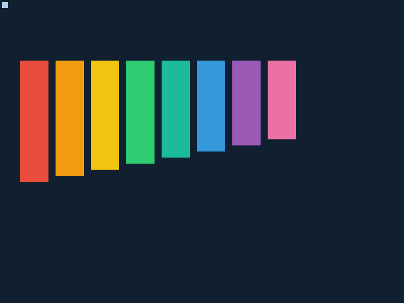

# E14 / G02 正式验收（2026-10-26）

**passed，限QEMU11.1.2 / pc-i440fx-10.0 / qemu64 / TCG / 单核512MiB。**
源码`23a3698`，build`01c8b149ecc0e4cf`。主回执[qualification.json](qualification.json)
绑定全部来源、产物和证据SHA-256；[source_manifest.json](source_manifest.json)保存逐文件来源。

- [G02](g02.json)：19组，含23项显示检查、真实PS/2、显存完整核对、故障/OOM/回收。
- [旧回归](regression.json)：9入口，72组客体功能与7份许可材料完整性检查。
- [兼容](compatibility.json)：5组，旧Dash/Make/CPython/C++线程payload未重建，哈希固定。
- [实际QEMU截图](xylophone.png)，[客体日志](logs/)，[保留失败](failures/)。
- `framebuffer.bin.gz`解压为1920000字节真实VRAM，原始摘要见qualification。

复现命令和用户接口见[display_backend.md](../../display_backend.md)，
失败原因与修复见[0051](../../work_log/0051_display_backend_e14.md)。
未验640×480回退/真机/SMP/长时压力/Qt；无窗口管理器/GPU/IME。
日常盘、旧发行与其他worktree不在本轮写入范围；PR供维护者审查，不直接合并main。
