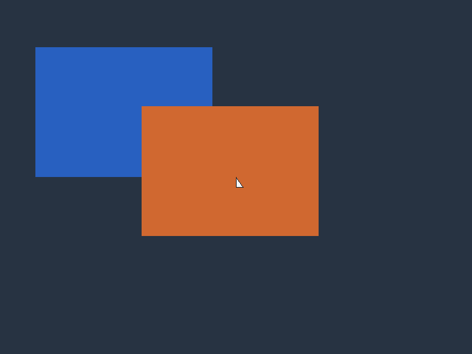

# P1-G: independent Mobius application windows

The matching ordinary and threading SDK consumers passed the complete real
guest scenario on system **`9143113dac0b4851`**. The applications have different
PIDs (`12` and `13`), independent authenticated sessions and different window
tokens. Actual QEMU PS/2 events drive the applications, and scanout screenshots
verify visible results. This qualification is separate from older single-surface
or same-process demonstrations.

| Configuration | Actual checks | Result |
| --- | ---: | --- |
| Ordinary SDK, native startup, no libc link | 15 groups | passed |
| Independently rebuilt threading SDK, POSIX startup and threaded newlib | 16 groups | passed |
| Host model, transport, demo and multiwindow suites | 4 suites; 106 assertions in the added suite | ASan/UBSan passed |

Both guests return exactly to **129789 free pages / 2 tasks / 0 completions**.
The independent thread consumer also creates and joins a real pthread, checks
separate TLS and errno values, then exercises the same window protocol. It uses
the threading SDK's own `crt0_posix.o`, `libxos.a`, `libc.a` and `libm.a`.

## Observed behavior

Two independent clients visibly paint overlapping windows. A focus change
raises the chosen window and routes keyboard input only to its owner. A key
release still reaches its original press owner after focus changes. A pointer
drag remains with the press owner while crossing the other application.

Partial-frame writes stay private until commit; cancel preserves the previous
front image. Resize and move restore the old extents. The right application
executes a real invalid instruction while a frame is pending: its window and
resources disappear, and the left application remains visible and accepts a
new input-driven update. Owner close returns the scene and resources to their
baseline.

The target rejects eleven foreign-token, invalid-alpha, stale-token and
resize-retirement cases, a wrong service peer, and malformed framing. Killing
the compositor wakes its client. A live unresponsive service meets the client's
original five-second deadline. Restarting the compositor yields fresh sessions
for two new applications. Finally, the existing exclusive-display `gfxdemo`
checks still pass after compositor shutdown.

The empty scene, partial-frame stages, resize/move and service restart images
are listed in `ordinary_guest.json` and `threading_guest.json`. Both complete
serial transcripts are included as deterministic gzip files. Images are actual
guest screen captures.

## Source and artifact binding

`builds.json` records the system image, both complete SDK identities, the actual
client ELF and runtime inputs, the fresh locked newlib source/patches, and
compiler/QEMU identities. `source_bindings.json.gz` binds 2305 system source
inputs and 261 threading SDK inputs; all were rechecked after execution and
again at public export. The producer receipts retain their build-only status.

`attempts.json` records the failed or unqualified development runs: an old hover
fixture that actually held a button, host LeakSanitizer's ptrace restriction,
an incomplete serial READY line, a source-changing build rejection, a screenshot
assertion on the cursor, and an initially mismatched threading CRT recipe.
Those attempts do not become successful because the final candidates passed.

Public JSON records are derived summaries. Host-local command inventories are
omitted; screenshot hashes live only in the flat root manifest. Raw local
report digests identify their unpublished origins, and the Git tree plus
`manifest.json` bind the public leaves. No historical report was edited.

## Limits and replay

The implementation retains Interactium wire version 1 and existing operations
1–14, with bounded copied tiles, four sessions and eight drawable surfaces
globally. Final scanout remains one exclusive display-v1 connection. Current
native/Qt clients using the existing valid create/tile/commit/destroy path keep
that wire layout; the stricter validation and real owner-close behavior are
specified in the [contract](../../contracts/mobius_multiwindow.md).

Qt packages, a C++ standard runtime GUI consumer, installed Mobius/ClarkE,
physical GPU hardware, SMP, glass effects and long-duration stress were not
qualified. LeakSanitizer is unavailable on this ptraced host; ASan/UBSan and
actual target resource return were tested independently. The compositor's idle
loop uses a ten-millisecond monotonic sleep because these existing display and
named-IPC interfaces do not have a common wait set.

Replay commands and the precise compatibility boundary are in the
[work log](../../work_log/4c08d7ab_p1_g_multiwindow.md). Rebuild into fresh output
directories with the pinned toolchain, freeze all source/test inputs before
the system build, and use `XOS_QMP_TRANSPORT=pipe` when the host requires it.
