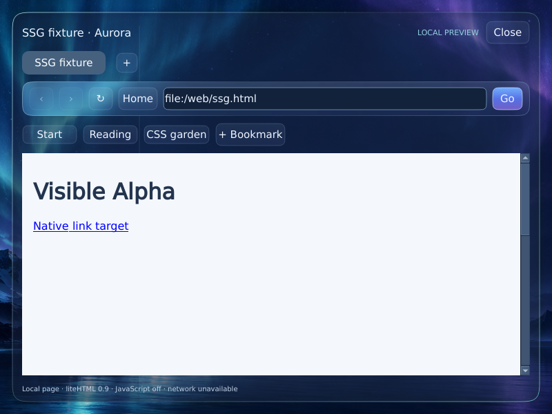

# SSG-P2F：Browser 分页结构与文本完整性

## 本轮结论

**A1 在两份固定、真实加载的 Browser 输入上 `PASSED_SCOPED`。**
独立 XOS Consumer 通过现有 Pipe 收到的全部节点，与客体实际 liteHTML 文档的
独立递归参考逐项一致。原 P2D 页面实际为 32 节点；新合法大页实际为 267 节点。
本轮实现和验收继续已有 [Draft PR #10](https://github.com/www080327-glitch/XylophoneOS/pull/10)。

| 范围 | 实际结果 |
|---|---|
| A1：完整 DOM 结构与文本 | 两份页面通过，包括 root、父子、兄弟顺序、角色、标签、精确文本与 href |
| 单个可见链接的几何 | Consumer 提供坐标，真实 PS/2 点击命中，通过限定检查 |
| 1025 UTF-16 单位文本 | 明确 `RESOURCE_LIMIT`；Consumer 拒绝将其记为完整读取 |
| 原 P1 管道及小 Browser | 普通 Browser 构建，16 项外层检查通过 |
| 原非分页 Browser 回归 | 原断言未修改，7 项检查通过；首次 snapshot 仍发生 TIME 截断 |
| 原 Gate A 整体 | **NOT_QUALIFIED**：未证明所有渲染片段与全局遮挡可见性 |
| Gate B / Gate C | 本轮暂缓；未实现 Consumer 分页 Diff，未验证分页期间交互恢复 |

机器可读总结果见 [report.json](report.json)。所有成功均限于报告所述范围，
不把 Provider 的 `complete=true`、旧 P1 检查或宿主测试当作独立完整性证明。

## 源码与构建身份

| 提交 | 内容 |
|---|---|
| `9a739c7052d66dd75c0a0aceb807b0e4aa2fc16f` | 原 P2E 基线，历史证据不变 |
| `0a63648d53e4a7491320111f053f8b93882fbdab` | 独立 Oracle、严格比较器、Consumer 检查、合法页面和可复现 probe |
| `a81b4fd7ab18ec09e87b311e8fe89cf4464fb63c` | 点击检查改为读取真实 framebuffer 尺寸；客体源码与 ELF 不变 |

系统镜像、Session、Consumer、Notes、普通 Browser 和测试 Browser 均从本轮源码实际构建，
没有复用旧 Mac 工作区的 ELF 或旧客体通过记录。系统 build ID 为 `8a3eac6ae1787d30`。
QEMU 11.1.2、GCC 16.2.0、NASM 3.02、指定 Binutils、newlib 和 Qt 6.8.3 的输入、命令、
二进制哈希及构建失败/恢复记录见 [build-evidence](build-evidence/README.md)。

构建身份详见 [source-freeze.json](source-freeze.json)、
[probe-screen-correction.json](probe-screen-correction.json) 与 [environment.json](environment.json)。
本轮 kernel、公共系统 ABI、QPA、驱动改动均为 0；没有新增 syscall、生产权限、Broker，
没有合并 main 或依赖分支，没有操作 PR #20、正式 LocalPilot 或用户代理配置。

## 独立参考如何建立

[test_structure_oracle.hpp](../../../src/ports/aurora_browser/test_structure_oracle.hpp)
使用简单递归，读取真实 `doc->root()` 及原生 children 顺序。
它不调用分页/非分页 SSG 枚举器，不复用 DFS continuation、scene IDs、分页预算或结束标志。
head、隐藏节点和视口外节点都保留；文本和空格不 trim、不合并、不截断。

参考在首次分页调用前和最终分页调用后各取一次，绑定实际加载字节的 SHA-256、document、
Provider PID、sourceInstance、epoch 和 revision。每条记录含规范化路径、父路径、
前序编号、子序号、子数、tag、role，以及完整 text/href。两份参考须精确一致。
摘要使用独立规定的 UTF-8 netstring 格式，Python 重新计算，不依赖 JSON 序列化顺序。

参考仅由 `--test-structure-oracle` 显式测试构建开启，不新增 IPC 操作，也不授予读取权限。
正常构建的标记为 false，二进制中没有 Oracle 日志或 schema 标记，见
[normal-browser-oracle-exclusion.json](normal-browser-oracle-exclusion.json)。
完整接口和摘要定义见 [P2F contract](../../contracts/ssg_p2f_structure_oracle.md)。

Consumer 现在检查精确分页标志、唯一 ID、唯一根、父先于子和合法前序顺序，
但仍输出 `completeness=ORACLE_REQUIRED`：这些局部条件本身无法发现整棵子树被漏掉。
测试器依据父 ID 重建路径与兄弟序，再与独立参考全量比对，不要求两套内部 ID 相同。

## 两份真实页面的结果

| 输入 | 字节 | 节点组成 | 分页 | 完整对照 |
|---|---:|---|---|---|
| 原 `p2d.html` | 424 | 10 element + 20 text + 2 link = **32** | `8,8,8,8,0` | 全部一致；空终止页正确 |
| 新 `p2f.html` | 1935 | 52 element + 206 text + 9 link = **267** | 33 页 × 8 + 最后 3 = **34 页** | 全部一致；最后数据页结束 |

两份均为未筛选完整树查询。缺失、额外、重复、父子/兄弟关系、tag/role、文本和 href
差异均为 0。新页面的 267 节点超过原非分页 96 次访问预算，分页预算没有被放大。
页面包含多层嵌套、多兄弟、空白、pre 换行、Unicode 实体、隐藏子树和视口外内容。
原 P2D 字节和 SHA-256 未修改。

| 项目 | SHA-256 |
|---|---|
| P2D 输入 | `37fff0e9d875d3196f3d547a4f65e0a329b1466623eac9d2a502554d18c41e0f` |
| P2D 规范化结构 | `5b4e296ce3415005a8482e31c0925d7a7d8a57009462f0a8ac32455785cd78e2` |
| P2F 输入 | `e8ec8487b810c264719400abc182b86b06d530aa9a34fb709fd92f5a8d27835f` |
| P2F 规范化结构 | `faaf0e1c343187cfb73504d0463484b3963b25c344debe95ffa729394424aef1` |

逐节点结果：[P2D 最终对照](guest-runs/p2d-oracle-03/structure-comparison.json)、
[P2F 对照](guest-runs/p2f-oracle-01/structure-comparison.json)。
真实参考分别保存在各运行的 `oracle-01.json` / `oracle-02.json`，来自客体模型，
不是把历史分页答案或宿主 HTML 解析伪装成期望结果。

另一个不导入项目验证器的审计脚本，从原始串口重新解码，以 ID 邻接表递归重建树，
再独立复算全部节点和摘要，结果一致：见 [independent-audit](independent-audit/README.md)。

## 单链接的真实几何证据

最终运行 `p2d-oracle-03` 从 Consumer 数据选中节点 13、`href=start.html`。
它的完整可见片段为 `[48,318,139,19]`；实际 framebuffer 为 **800×600**。
发送真实 QEMU PS/2 相对位移及一次左键按下/松开，点击 **(56,326)**，客体随后记录
`BROWSER_LINK target=/web/start.html` 和实际页面加载。
目标在该文档中唯一，避免点到另一条同目标链接也被算成功。

[QMP 事件](guest-runs/p2d-oracle-03/qmp-events.json) 与
[客体串口](guest-runs/p2d-oracle-03/serial.log.gz) 保留完整顺序。
这发生在分页完成后，不属于 Gate C 的分页中交互，也不证明所有节点几何或全局遮挡。
两份正例均未报告 `fragmentsComplete=false`，但这只是 Provider 字段，不能替代全局几何 Oracle。

## 超限拒绝、权限和资源

`p2f_text_limit.html` 通过未修改的 HTML 准入检查。实际 Oracle 有 7 节点；
路径 `0/1/0/0`、ordinal 5 的文本为 **1025 UTF-16 code units**。
Provider 返回 `RESOURCE_LIMIT`，Consumer 收到 0 个成功节点、`complete=0`、退出 code 1；
Provider 正常退出 code 0。没有成功页字段，也没有把资源拒绝包装为完整读取。
见 [resource-rejection.json](guest-runs/text-limit-01/resource-rejection.json)。

三进程身份在真实日志中分离：Session PID 10、Consumer PID 11、Provider PID 12。
资源字段为 `free pages / tasks / completions`：

| 阶段 | 实际计数 |
|---|---|
| 显示服务启动前 | `[130279,2,0]` |
| 显示服务运行、子进程启动前 | `[130235,3,1]` |
| 两个子进程退出后 | `[130235,3,1]` |
| 完整 P1 回归停止并回收显示服务后 | `[130279,2,0]` |

Oracle 正例比较的是子进程前后的同一显示服务基线，没有把仍运行的显示服务说成已回收。
正常 Browser 的 P1 还实际检查默认文本权限拒绝、本地 probe 不扩大 Pipe 权限、
背压、截断帧、超大帧、超时、旧引用、真实编辑/滚动/重载与回收。

## 旧回归与失败记录

- [P1 + 小 Browser](guest-runs/p1-regression-01/report.json)：当前正常构建，16 项外层检查 `PASSED_SCOPED`。
- [旧非分页 Browser](guest-runs/large-regression-01/report.json)：原测试和断言字节不变，7 项 `PASSED`。
  **其首次 snapshot 仍 `capped=true / capReason=TIME`，之后的重新导航、完整基线与滚动检查通过。**
  没有修改非分页算法；没有进行同镜像、同宿主的受控性能 A/B，不能声称时间截断根治，
  也不能将这次通过归因于分页功能。详见 [legacy-regression-scope.json](legacy-regression-scope.json)。
- [首次启动失败](guest-runs/p2d-oracle-01/report.json)：沙箱禁止绑定 QMP Unix socket，QEMU 退出，
  串口为空，未观察到客体启动。使用获准的本地 socket 执行条件后另开新目录重跑，失败记录保留。
- [早期真实通过运行](guest-runs/p2d-oracle-02/report.json) 保留；它实际点击位置有效，之后将宿主
  检查从硬编码尺寸收紧为读取真实截图尺寸，再运行新的 03 作为最终链接证据。
- 构建阶段的 QEMU 归档/固件问题及修复核对记录保留在 build-evidence；没有把构建失败当客体通过。
- 原 P2D/P2E 冻结成功、观察和失败材料全部未改写。本轮没有沿用 #32 的 107 项组合结果。

52 项宿主验证器测试覆盖删整棵子树仍声称 complete、重复/错误父 ID、兄弟交换、文本/href
篡改、缺页、错源、损坏帧、冲突退出以及资源拒绝关联错误。
[validator-tests.log](validator-tests.log) 的通过只说明检查器能够拒绝这些损坏输入，
不是客体资格。三个页面的实际准入函数宿主检查亦单列在 [host-admission](host-admission/report.json)。

## 原始证据与复现

每个运行目录提供原报告、原始 Oracle/对照、输入及串口压缩文件。
`capture.tar.gz` 保存该运行的完整原文件，包括每一个 IPC JSON、`.wire`、QEMU 日志、
receipt、截图及 runner 输出；`archive-manifest.json` 给出每个归档成员的长度与 SHA-256，
打包后逐项重新解压校验。

`.wire` 的 12 字节 header 是从已验证协议字段重建的，payload 是 Consumer 原样记录的字节。
这是明确标注的重建，不冒充另一套线上原始 header 抓包。

最终主要证据：[P2D](guest-runs/p2d-oracle-03/archive-manifest.json)、
[P2F](guest-runs/p2f-oracle-01/archive-manifest.json)、
[超限](guest-runs/text-limit-01/archive-manifest.json)、
[P1](guest-runs/p1-regression-01/archive-manifest.json)、
[旧回归](guest-runs/large-regression-01/archive-manifest.json)。
所有客体按顺序执行，开始前编译任务已停止；不作性能收益结论。

复现脚本保留显式 image / Session / Browser / Consumer / HTML / 新输出目录参数。
使用匹配的 SDK/Qt 重新构建后，按 [contract 的命令](../../contracts/ssg_p2f_structure_oracle.md#fixtures-and-reproduction)
执行，软盘镜像用 `--image-format floppy`。本轮实际命令、输入哈希和 QEMU 参数均在原报告。
下载归档后可 `tar -xzf capture.tar.gz` 得到完整运行目录，再运行独立审计脚本。

## 剩余边界

本轮没有发现需修改生产 DFS 核心的漏节点问题；实际新增的是独立模型参考、严格比较与
Consumer 一致性防线。结论限于两份真实输入，不是对所有合法页面的形式化证明。

仍未验收：全节点渲染片段完整性、全局遮挡、过滤分页查询、4096 ID 边界、完整游标生命周期、
分页期间真实输入及失效恢复、完整 A/B 基线与 Consumer-computed Diff。
1024 UTF-16 文本上限、既有每页/访问/时间和 HTML 准入预算保持原值。
Notes PR #9 安全补测、多 Provider、LocalPilot 和现代网页功能未推进。
GitHub CI 没有被宣称通过；PR 保持 Draft，未合并。

下一独立阶段才是：完整基线 A → 实际滚动 → 完整基线 B → Consumer-computed Diff。
